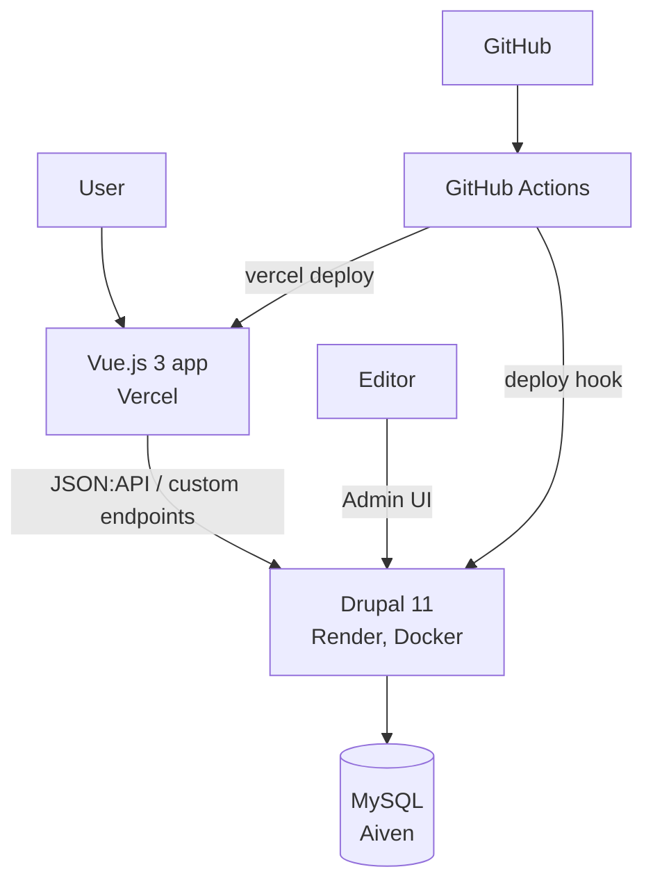

# Headless Blog — Vue.js 3 + Drupal 11

A content-driven blog built as a **headless CMS** application. Editors write and publish
articles in the Drupal admin panel; a separate Vue.js 3 single-page app reads that content
through Drupal's **JSON:API** and renders the public website. No blog content is hardcoded in
the frontend — a post published in Drupal appears on the website on the next page load.

| | |
|---|---|
| **Live website (Vue.js)** | `https://<your-project>.vercel.app` |
| **Drupal CMS / API** | `https://<your-service>.onrender.com` (admin: `/user/login`) |
| **Repository** | `https://github.com/<your-user>/drupal-vue-headless-blog` |

> The Drupal service runs on Render's free tier and sleeps when idle. The first request after a
> pause can take 30–60 seconds; the Vue app shows a loading state and a retry button meanwhile.

---

## Contents

- [Features](#features)
- [Architecture](#architecture)
- [Tech stack](#tech-stack)
- [Repository structure](#repository-structure)
- [Local setup](#local-setup)
- [Environment variables](#environment-variables)
- [Drupal content model](#drupal-content-model)
- [API](#api)
- [Frontend](#frontend)
- [CI/CD](#cicd)
- [Deployment](#deployment)
- [Using the CMS](#using-the-cms)
- [Security notes](#security-notes)
- [Known limitations](#known-limitations)

---

## Features

**Core**
- Blog content type and Category vocabulary managed entirely in the Drupal admin panel
- Homepage: header, navigation, featured blogs, latest blogs, categories, footer
- Blog listing: cards with image, title, short description, category and date
- Server-side **search**, **category filtering** and **pagination** (all done by JSON:API queries)
- Blog detail page on clean URLs: `/blog/my-first-blog`
- Loading skeletons, error states with retry, empty states and a 404 page

**Bonus**
- **Authentication** — log in with a Drupal account; `/profile` is protected by a router guard and a Drupal endpoint that requires a session
- **Contact form** — Vue form posts to Drupal, which validates, rate-limits and stores the message
- **Responsive** design for desktop, tablet and mobile
- **SEO** — per-page title, meta description, canonical URL and Open Graph tags; clean URLs via the History API
- **Docker** — `docker-compose.yml` runs Drupal + MariaDB locally

---

## Architecture

```
                    User (browser)
                          │
                          ▼
         ┌────────────────────────────────┐
         │  Vue.js 3 SPA        (Vercel)  │  static files on a CDN
         └────────────────────────────────┘
                          │  HTTPS + CORS
                          │  GET /jsonapi/...   POST /api/contact
                          ▼
         ┌────────────────────────────────┐
         │  Drupal 11 API        (Render) │  JSON:API (read-only)
         │  + Drupal CMS admin panel      │  custom module: headless_blog
         └────────────────────────────────┘
                          │  TLS
                          ▼
         ┌────────────────────────────────┐
         │  MySQL 8               (Aiven) │  content, users, config
         └────────────────────────────────┘

  GitHub ──► GitHub Actions ──► Vercel (frontend) / Render deploy hook (Drupal)
```



**How a request flows:** the browser loads the static Vue app from Vercel. Vue Router renders a
view, which calls `src/services/api.js`. That module builds a JSON:API URL from
`VITE_DRUPAL_API_URL` (e.g. `/jsonapi/node/blog?filter[field_category.id]=…&include=…`), Drupal
checks access, loads the entities from MySQL and returns JSON:API documents. `api.js`
normalises them into simple objects that the components render.

---

## Tech stack

| Layer | Technology |
|---|---|
| Frontend | Vue 3 (Composition API, `<script setup>`), Vue Router, Vite, DOMPurify |
| Frontend quality | ESLint (`eslint-plugin-vue`), Vitest + Vue Test Utils |
| CMS / API | Drupal 11.4, core JSON:API, Drush 13, custom module `headless_blog` |
| Database | MySQL 8 (Aiven) in production, MariaDB 11.4 locally and in CI |
| Backend quality | PHPCS with Drupal / DrupalPractice standards, config validation |
| Infrastructure | Vercel (frontend), Render Docker web service (Drupal), Aiven (MySQL) |
| CI/CD | GitHub Actions |

---

## Repository structure

```
drupal-vue-headless-blog/
├── frontend/                     Vue.js 3 application
│   ├── src/
│   │   ├── components/           AppHeader, AppFooter, BlogCard, CategoryFilter,
│   │   │                         SearchBar, PaginationNav, LoadingState, ErrorState
│   │   ├── views/                HomeView, BlogList, BlogDetail, ContactPage,
│   │   │                         LoginPage, ProfilePage, NotFound
│   │   ├── services/api.js       Drupal API client (JSON:API queries + normalisation)
│   │   ├── composables/          useAsync, useCategories, useSeo
│   │   ├── stores/auth.js        Shared login state
│   │   ├── router/index.js       Routes and auth guard
│   │   └── App.vue
│   ├── .env.example
│   └── vercel.json               SPA rewrites for clean URLs
│
├── drupal/                       Drupal 11 (Composer project)
│   ├── config/sync/              Exported configuration = the content model
│   ├── web/modules/custom/headless_blog/
│   ├── web/sites/default/settings.php   reads everything from env vars
│   ├── docker/                   entrypoint + php.ini
│   ├── Dockerfile                used locally and on Render
│   └── composer.json / composer.lock
│
├── .github/workflows/
│   ├── frontend.yml
│   └── drupal.yml
├── docker-compose.yml            Drupal + MariaDB for local development
├── render.yaml                   Render blueprint for the Drupal service
├── .env.example
└── README.md
```

The header/footer components are named `AppHeader`/`AppFooter` rather than `Header`/`Footer`
because Vue's style guide requires multi-word component names, so they never clash with the
native `<header>`/`<footer>` elements.

---

## Local setup

**Requirements:** Docker (with Compose) and Node.js 20.19+.

### 1. Clone

```bash
git clone https://github.com/<your-user>/drupal-vue-headless-blog.git
cd drupal-vue-headless-blog
```

### 2. Drupal + database

```bash
cp .env.example .env
# edit .env: set DB_PASSWORD, DB_ROOT_PASSWORD, DRUPAL_ADMIN_PASS and DRUPAL_HASH_SALT
docker compose up -d --build
docker compose logs -f drupal     # wait for "apache2 -D FOREGROUND"
```

On the first start the container:
1. runs `composer install`,
2. installs Drupal **from `drupal/config/sync`** (`drush site:install --existing-config`),
3. runs `drush headless-blog:seed` to create the four categories and eight sample posts.

On later starts it runs `drush deploy` (database updates + config import) instead.

- Drupal admin: <http://localhost:8080/user/login> (user `admin`, password from `DRUPAL_ADMIN_PASS`)
- JSON:API: <http://localhost:8080/jsonapi/node/blog>

Useful commands:

```bash
docker compose exec drupal drush cr          # clear caches
docker compose exec drupal drush config:export -y   # export config after changing the content model
docker compose exec drupal drush uli         # one-time admin login link
docker compose down -v                       # stop and delete the database
```

### 3. Frontend

```bash
cd frontend
cp .env.example .env        # VITE_DRUPAL_API_URL=http://localhost:8080
npm install
npm run dev                 # http://localhost:5173
```

Other scripts: `npm run lint`, `npm test`, `npm run build`, `npm run preview`.

### Composer build lifecycle (Drupal)

`drupal/composer.json` defines scripts that Composer runs as part of its lifecycle, plus named
commands used by developers, CI and Docker:

| Script | When it runs | What it does |
|---|---|---|
| `post-install-cmd` / `post-update-cmd` | automatically after `composer install` / `composer update` | calls `build-themes` |
| `composer build-themes` | via the hooks above, or manually | runs `npm ci && npm run build` in every `web/themes/custom/*` theme with a `package.json` ([`scripts/build-custom-themes.sh`](drupal/scripts/build-custom-themes.sh)) |
| `composer lint` / `composer lint:fix` | CI and developers | PHPCS / PHPCBF with the Drupal and DrupalPractice standards |
| `composer site:install` | CI | `drush site:install --existing-config` |
| `composer site:deploy` | manually | `drush deploy` (database updates + config import + cache rebuild) |

Compiled theme assets are therefore produced during the build, never committed. This site is
headless, so there is currently **no custom Drupal theme**: the public site is the Vue app
(compiled by Vite in its own pipeline) and the admin uses core's Claro. The hook reports
"nothing to build" today and starts compiling automatically as soon as a theme with a
`package.json` is added. In that case the Docker image would also need Node.js, for example
a Node build stage. `SKIP_THEME_BUILD=1` skips the step in PHP-only environments.

In the production Docker image, `composer install` runs before the full source is copied in
(to cache the dependency layer), so the Dockerfile runs `composer build-themes` again after
`COPY . .`.

---

## Environment variables

Nothing secret is committed. Templates: [`.env.example`](.env.example) (Drupal / Docker) and
[`frontend/.env.example`](frontend/.env.example).

### Frontend (`frontend/.env`, Vercel project settings)

| Variable | Required | Description |
|---|---|---|
| `VITE_DRUPAL_API_URL` | yes | Base URL of Drupal, no trailing slash, e.g. `https://headless-blog-cms.onrender.com` |
| `VITE_SITE_NAME` | no | Name shown in the header and page titles |

### Drupal (`.env` locally, Render environment in production)

| Variable | Description |
|---|---|
| `DB_HOST`, `DB_PORT`, `DB_NAME`, `DB_USER`, `DB_PASSWORD` | Database connection |
| `DB_ROOT_PASSWORD` | Local MariaDB container only |
| `DB_SSL_CA_PEM` | Production only: CA certificate (PEM text) for TLS to Aiven MySQL |
| `DRUPAL_HASH_SALT` | Random string used by Drupal for one-time links and tokens |
| `DRUPAL_ADMIN_USER`, `DRUPAL_ADMIN_PASS`, `DRUPAL_ADMIN_MAIL` | Admin account created on first install |
| `DRUPAL_SITE_NAME` | Site name used on install |
| `TRUSTED_HOST_PATTERNS` | Comma-separated regexes of allowed host names |
| `CORS_ALLOWED_ORIGINS` | Comma-separated origins allowed to call the API (the Vue app URL) |
| `SESSION_COOKIE_SAMESITE` | `Lax` locally; `None` in production because Vue and Drupal are on different domains |
| `REVERSE_PROXY` | `true` on Render so Drupal trusts `X-Forwarded-*` headers (HTTPS detection) |

### GitHub Actions secrets

| Secret | Used by |
|---|---|
| `VERCEL_TOKEN`, `VERCEL_ORG_ID`, `VERCEL_PROJECT_ID` | `frontend.yml` deploy job |
| `RENDER_DEPLOY_HOOK_URL` | `drupal.yml` deploy job |

Optional repository variable `VITE_DRUPAL_API_URL` is used for the CI build check.

---

## Drupal content model

All of this lives in `drupal/config/sync` and is applied automatically on install/deploy.

### Blog (content type `blog`)

| Requirement | Field | Type |
|---|---|---|
| Title | `title` | core title |
| Short Description | `field_short_description` | plain text (long) |
| Full Content | `body` | formatted text, *Basic HTML* with CKEditor 5 |
| Featured Image | `field_featured_image` | image (alt text required) |
| Author | `uid` | core author reference |
| Category | `field_category` | reference to *Category* terms |
| Published Date | `field_published_date` | date & time, defaults to now |
| Status | `status` | core published / unpublished |
| *(extra)* Featured on homepage | `field_featured` | boolean |
| *(extra)* URL slug | `field_slug` | text, generated from the title when left empty |

### Category (vocabulary `category`)

Seeded with **Technology, Business, Cloud, AI**. Editors can add, rename, reorder or delete
categories in *Structure → Taxonomy → Category*; the website's filter buttons update automatically.

### Contact submission (content type `contact_submission`)

Stores messages from the website contact form (name, email, message). Always unpublished and
hidden from anonymous users, including over JSON:API.

### Roles

- **Administrator** — full access.
- **Content editor** — create/edit/delete blogs, manage categories, read contact submissions.
- **Anonymous** — read published content only. JSON:API is configured as **read-only**, so
  content can only be changed through the admin UI.

### Custom module `headless_blog`

| File | Purpose |
|---|---|
| `src/Hook/HeadlessBlogHooks.php` | On save: generates a unique slug and sets the `/blog/{slug}` path alias; keeps contact submissions private |
| `src/SlugGenerator.php` | Transliterates titles into unique URL slugs |
| `src/HeadlessBlogServiceProvider.php` | Configures CORS and the session cookie `SameSite` policy from env vars |
| `src/Controller/ContactController.php` | `POST /api/contact` — validation, honeypot, flood control, stores submission |
| `src/Controller/ProfileController.php` | `GET /api/me` — current user for the protected profile page |
| `src/Drush/Commands/HeadlessBlogCommands.php` | `drush headless-blog:seed` — initial categories and sample posts |

---

## API

Base URL = `VITE_DRUPAL_API_URL`. All public reads use core **JSON:API**.

| Purpose | Request |
|---|---|
| Latest blogs (page 2, 9 per page) | `GET /jsonapi/node/blog?filter[status]=1&sort=-field_published_date&page[limit]=9&page[offset]=9&include=field_category,field_featured_image,uid` |
| Featured blogs | `… &filter[field_featured]=1&page[limit]=3` |
| Filter by category | `… &filter[field_category.id]={term uuid}` |
| Search "Vue" | `… &filter[search][group][conjunction]=OR` plus `title`, `field_short_description` and `body.value` `CONTAINS "Vue"` conditions that are `memberOf` that group |
| Blog by slug | `GET /jsonapi/node/blog?filter[field_slug]=my-first-blog&include=…` |
| Categories | `GET /jsonapi/taxonomy_term/category?sort=weight,name` |
| Contact form | `POST /api/contact` `{name, email, message}` → `201` / `422` with field errors / `429` |
| Log in | `POST /user/login?_format=json` `{name, pass}` (Drupal core) |
| Current user | `GET /api/me` (session cookie) → `200` / `403` |
| Log out | `POST /user/logout?_format=json&token={logout_token}` (Drupal core) |

Requests use sparse fieldsets (`fields[node--blog]=…`) so only the needed fields are sent.
Pagination uses JSON:API's `links.next` / `links.prev`.

**Why new content appears immediately:** the Vue app has no copy of the content; every page view
queries the API. Drupal's page cache is invalidated by cache tags when a node or term is saved,
so the next API response already includes the change.

---

## Frontend

| Requirement | Where |
|---|---|
| Components / reusable components | `src/components/*` — e.g. `BlogCard` is used on the homepage, listing and related posts |
| Vue Router | `src/router/index.js` — lazy-loaded routes, `/blog/:slug`, auth guard on `/profile` |
| API integration | `src/services/api.js` |
| Props | `BlogCard` (`blog`, `variant`), `PaginationNav` (`page`, `hasNext`, …), `ErrorState` (`message`) |
| Events | `CategoryFilter` emits `update:modelValue` (v-model), `SearchBar` emits debounced `search`, `PaginationNav` emits `change`, `BlogCard` emits `select-category`, `ErrorState` emits `retry` |
| Reactive state | `ref`/`computed` in views, shared state in `useCategories` and `stores/auth.js` |
| Loading states | `useAsync` composable + `LoadingState` skeletons |
| Error handling | `ApiError` in `api.js`, `ErrorState` with retry, form validation messages, 404 handling |

Listing filters (`?q=`, `?category=`, `?page=`) are stored in the URL, so filtered pages can be
shared and the back button works. Rich text from Drupal is filtered by Drupal's text format and
sanitized again with DOMPurify before rendering.

---

## CI/CD

### Frontend — `.github/workflows/frontend.yml`

```
push / pull request (frontend/**)
  → npm ci → ESLint → Vitest unit tests → vite build → upload dist artifact
  → (push to main only) vercel pull → vercel build → vercel deploy --prod
```

### Drupal — `.github/workflows/drupal.yml`

```
push / pull request (drupal/**)
  ├─ validate: composer validate → composer install → php -l → PHPCS (Drupal standards)
  │            → drush site:install --existing-config (MariaDB service container)
  │            → configuration validation: drush config:status must report no differences
  │            → seed + API smoke test (JSON:API list, slug lookup, contact 201, /api/me 403)
  ├─ docker:   build the production Docker image
  └─ deploy:   (push to main only, after both jobs pass) POST to the Render deploy hook
```

Pull requests run all checks but never deploy. Deploy jobs skip with a warning if their
secrets are not configured, so forks still get green CI.

---

## Deployment

| Component | Host | Notes |
|---|---|---|
| Vue.js app | **Vercel** (Hobby, free) | Static build on a CDN; `vercel.json` rewrites all paths to `index.html` |
| Drupal | **Render** web service (free) | Built from `drupal/Dockerfile` (`render.yaml` blueprint), auto-deploy off |
| Database | **Aiven for MySQL** (free plan) | TLS connection using the Aiven CA certificate |

### How a Drupal deploy works

1. A change is merged into `main`.
2. `drupal.yml` validates the code and config and builds the image.
3. The deploy job calls Render's deploy hook; Render builds `drupal/Dockerfile` (`prod` stage:
   `composer install --no-dev`, code baked into the image).
4. On start, `docker/entrypoint.sh` waits for MySQL, then runs `drush deploy`
   (`updatedb` + `config:import` + cache rebuild). On an empty database it runs
   `drush site:install --existing-config` instead. It checks for an existing table first, so a
   temporary connection problem can never trigger a reinstall.

### One-time setup

**Aiven (MySQL)**
1. Create a free MySQL service. Note host, port, user, password and database (`defaultdb`).
2. Download the CA certificate.
3. If install fails with a primary-key error, set `sql_require_primary_key` to off under
   *Advanced configuration*.

**Render (Drupal)**
1. *New → Blueprint* and select this repository (uses `render.yaml`), or create a Docker web service with root `drupal`.
2. Fill in the environment variables: `DB_*` from Aiven, `DB_SSL_CA_PEM` = contents of the CA file,
   `DRUPAL_ADMIN_PASS`, `DRUPAL_ADMIN_MAIL`,
   `TRUSTED_HOST_PATTERNS=^headless-blog-cms\.onrender\.com$`,
   `CORS_ALLOWED_ORIGINS=https://<your-project>.vercel.app`.
3. *Settings → Deploy Hook*: copy the URL into the GitHub secret `RENDER_DEPLOY_HOOK_URL`.

**Vercel (Vue)**
1. *Add New → Project*, import the GitHub repository and set **Root Directory** to `frontend`
   (framework preset: Vite).
2. Add `VITE_DRUPAL_API_URL` (the Render URL) under *Environment Variables* and deploy.
3. Create GitHub secrets: `VERCEL_PROJECT_ID` (*Project → Settings → General*),
   `VERCEL_ORG_ID` (*Account Settings → General → Vercel ID*, or the Team ID for a team) and
   `VERCEL_TOKEN` (*Account Settings → Tokens*).
4. *Project → Settings → Git → Ignored Build Step*: choose "Don't build anything", so pushes are
   deployed only by GitHub Actions after CI passes.

---

## Using the CMS

1. **Log in** — open `<drupal-url>/user/login` and sign in.
2. **Create a category** — *Structure → Taxonomy → Category → + Add term*. Enter a name
   (e.g. *DevOps*) and an optional description, then *Save*.
3. **Create a blog** — *Content → + Add content → Blog*. Fill in the title, short description and
   full content; choose a category; upload a featured image and enter its alt text. Leave
   *URL slug* empty to generate it from the title. Optionally tick *Featured on homepage*.
4. **Publish** — tick *Published* and *Save*.
5. Open the Vue website: the post is in *Latest articles*, on `/blog`, under the new category
   filter and at `/blog/<slug>` — without any change to the frontend code.

Contact form messages are listed under *Content* (type *Contact submission*).

---

## Security notes

- No credentials in the repository: `settings.php` reads all secrets from environment
  variables, and `.env` files are git-ignored (`.env.example` files hold placeholders only).
- JSON:API is read-only; writes happen only through the Drupal admin UI or the purpose-built
  contact endpoint (validated, honeypot, 5 messages/hour per IP).
- CORS only allows the configured frontend origins.
- Contact submissions are blocked for anonymous users at the entity-access level.
- HTML from the CMS is sanitized with DOMPurify before rendering.
- The Docker entrypoint refuses to install over an unreachable database.

---

## Known limitations

- **Cold starts:** Render free services sleep after inactivity; the first API call can take up to a minute.
- **Uploaded files on Render's free tier are ephemeral.** The database (Aiven) is persistent, but
  images uploaded through the admin UI are lost when the container restarts or redeploys.
  The seed images are restored automatically on every boot. A production setup would store files
  on object storage (e.g. the `s3fs` module with S3 or Cloudflare R2) or use a persistent disk.
- **Cross-site login cookie:** the login session uses a `SameSite=None` cookie because Vue and
  Drupal run on different domains. Browsers that block third-party cookies (Safari, or Firefox
  with strict settings) will not keep the session; serving both from one domain would fix this.
- **Open Graph for SPAs:** meta tags are set client-side. Google renders JavaScript, but some
  social networks only read the initial HTML; server-side rendering or prerendering would cover them.
- JSON:API in core does not return a total count, so pagination is previous/next rather than numbered pages.
